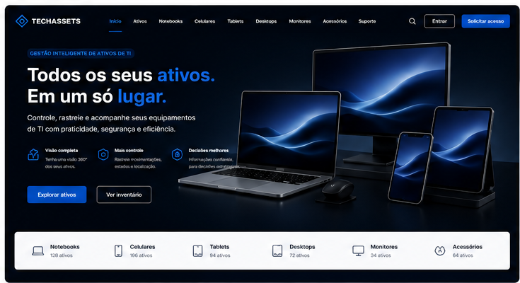
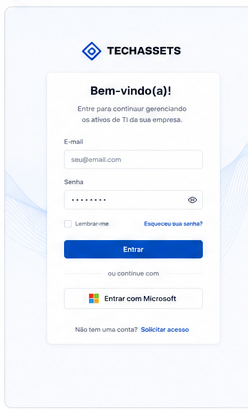
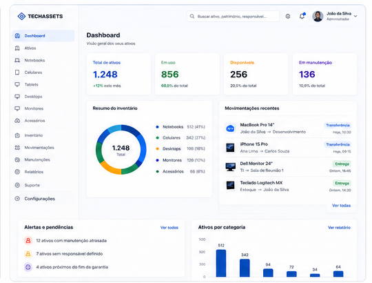
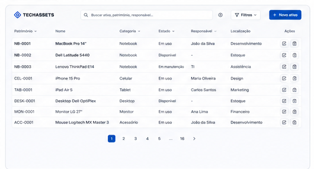
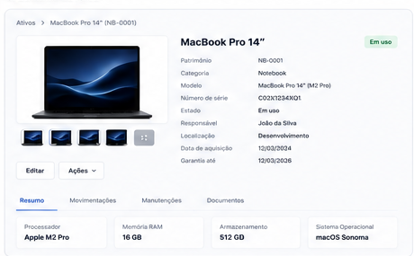
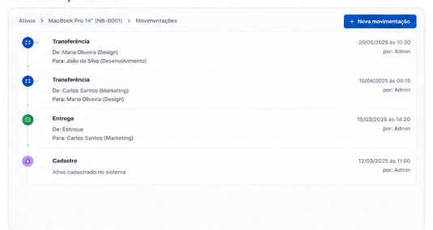
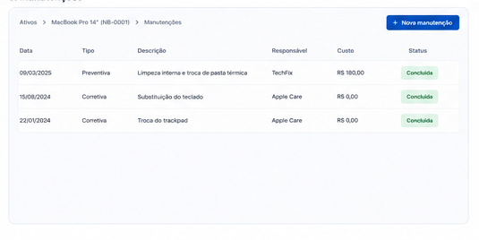
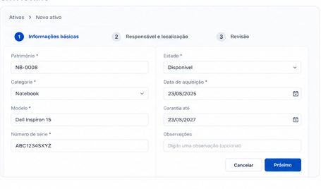
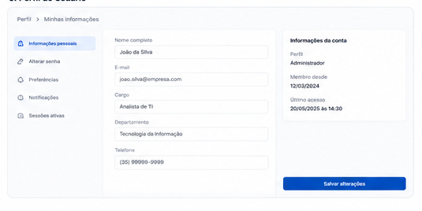

# FAEX — Engenharia de Software
## Evidências da Semana 04 — Protótipo de Alta Fidelidade & Interface UI

**Projeto:** TechAssets — Gestão e Rastreabilidade de Ativos de TI  
**Repositório:** [MateusGomesSilva/TechAssets](https://github.com/MateusGomesSilva/TechAssets)  
**Dupla:** Luiz Gabriel de Moraes & Mateus Gomes da Silva  

---

## Galeria de Evidências Visuais (Telas da Aplicação)

| Nº | Tela / Componente | Imagem de Evidência |
| :---: | :--- | :--- |
| **01** | Banner e Página Inicial |  |
| **02** | Login de Usuário |  |
| **03** | Dashboard de Ativos |  |
| **04** | Listagem de Ativos |  |
| **05** | Detalhes do Ativo |  |
| **06** | Histórico de Movimentações |  |
| **07** | Manutenções do Ativo |  |
| **08** | Formulário de Novo Ativo |  |
| **09** | Perfil do Usuário |  |
