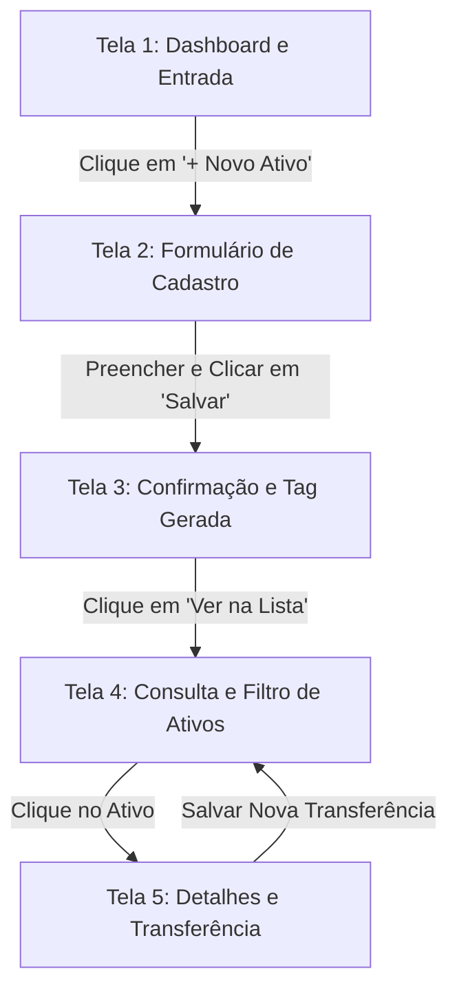

# FAEX — Engenharia de Software
## Semana 03 | Laboratório 2 — Protótipo de Baixa Fidelidade

**Projeto:** TechAssets — Gestão de Ativos de TI  
**Equipe:** Luiz Gabriel de Moraes & Mateus Gomes da Silva  
**Data:** 24/08/2026  
**Tarefa GitHub:** [#2 — E03-LAB2: Protótipo de Baixa Fidelidade](https://github.com/MateusGomesSilva/TechAssets/issues/2)  

---

## 1. Objetivo do Protótipo

Representar visualmente a jornada principal da primeira iteração (cadastro, consulta e movimentação de ativos de TI) através de um **protótipo de baixa fidelidade** (wireframe funcional), permitindo validar a navegação, os critérios de aceitação e os limites de escopo antes do desenvolvimento em código.

---

## 2. Diagrama do Fluxo da Jornada Principal



---

## 3. Wireframes de Baixa Fidelidade (Telas 1 a 5)

### Tela 1: Entrada / Dashboard Inicial (US-01 / US-02)
> **Pergunta:** Como o usuário inicia a jornada?  
> **Descrição:** O usuário visualiza o resumo de ativos e acessa o botão de ação principal.

```
+-----------------------------------------------------------------------+
| [TechAssets]  Gestão de Ativos de TI              [Usuário: Suporte]  |
+-----------------------------------------------------------------------+
| DASHBOARD                                                             |
| +-------------------+  +-------------------+  +-------------------+   |
| | Total Ativos: 42  |  | Em Uso: 30        |  | Manutenção: 4     |   |
| +-------------------+  +-------------------+  +-------------------+   |
|                                                                       |
| [ + NOVO ATIVO ]   [ CONSULTAR BASE ]                                |
+-----------------------------------------------------------------------+
```

---

### Tela 2: Formulário de Cadastro do Ativo (US-01)
> **Pergunta:** O que o usuário precisa informar ou fazer?  
> **Descrição:** Formulário com os campos essenciais para tombamento do equipamento.

```
+-----------------------------------------------------------------------+
| TechAssets > Novo Ativo                                               |
+-----------------------------------------------------------------------+
| CADASTRO DE EQUIPAMENTO (US-01)                                       |
|                                                                       |
| Nome do Ativo*:    [ Notebook Dell Latitude 3420                    ] |
| Categoria*:        [ Notebooks                         [v]          ] |
| Nº de Série*:      [ SN-DELL-987654                                 ] |
| Status Inicial*:   [ Disponível                        [v]          ] |
| Responsável:       [ Carlos Eduardo - TI                            ] |
| Filial/Setor*:     [ Matriz - Extrema/MG               [v]          ] |
|                                                                       |
| [*] Campos Obrigatórios                                               |
|                                                                       |
| [ SALVAR ATIVO ]    [ CANCELAR ]                                      |
+-----------------------------------------------------------------------+
```

---

### Tela 3: Resposta / Confirmação do Registro (US-01)
> **Pergunta:** Como o sistema responde à ação?  
> **Descrição:** Exibição da confirmação com o código de identificação patrimonial gerado.

```
+-----------------------------------------------------------------------+
| TechAssets > Confirmação                                              |
+-----------------------------------------------------------------------+
| [ V ] ATIVO CADASTRADO COM SUCESSO!                                   |
|                                                                       |
| Código Patrimonial Gerado: TAG-2026-0043                              |
| Equipamento: Notebook Dell Latitude 3420                              |
| Número de Série: SN-DELL-987654                                       |
| Responsável: Carlos Eduardo - TI                                      |
| Status: DISPONÍVEL                                                    |
|                                                                       |
| [ VER NA LISTA DE ATIVOS ]    [ CADASTRAR OUTRO ATIVO ]               |
+-----------------------------------------------------------------------+
```

---

### Tela 4: Consulta e Filtro de Ativos (US-02)
> **Pergunta:** Como o usuário verifica o resultado?  
> **Descrição:** Tabela interativa de busca por texto e filtragem por status.

```
+-----------------------------------------------------------------------+
| TechAssets > Consulta de Ativos (US-02)                               |
+-----------------------------------------------------------------------+
| Buscar: [ Dell               ]   Status: [ Todos [v] ]  [ FILTRAR ]   |
+-----------------------------------------------------------------------+
| TAG          | NOME               | SÉRIE        | STATUS     | AÇÃO  |
+--------------+--------------------+--------------+------------+-------+
| TAG-2026-0043| Notebook Dell 3420 | SN-DELL-9876 | DISPONÍVEL | [Ver] |
| TAG-2026-0012| Monitor ThinkVision| SN-LNV-1122  | EM USO     | [Ver] |
| TAG-2026-0005| Servidor PowerEdge | SN-DELL-0099 | MANUTENÇÃO | [Ver] |
+-----------------------------------------------------------------------+
```

---

### Tela 5: Detalhe e Movimentação do Ativo (US-03)
> **Pergunta:** Qual é o próximo passo ou encerramento da jornada?  
> **Descrição:** Visualização do histórico do ativo e transferência de responsável.

```
+-----------------------------------------------------------------------+
| TechAssets > Detalhes > TAG-2026-0043                                 |
+-----------------------------------------------------------------------+
| ATIVO: Notebook Dell Latitude 3420 | Status: DISPONÍVEL               |
|                                                                       |
| TRANSFERIR RESPONSÁVEL (US-03):                                       |
| Novo Responsável: [ Ana Paula - RH                              ]    |
| Nova Localização: [ Filial Extrema - Bloco B                    ]    |
| Motivo:           [ Empréstimo Corporativo                      ]    |
|                                                                       |
| [ CONFIRMAR TRANSFERÊNCIA ]                                           |
|                                                                       |
| HISTÓRICO DE MOVIMENTAÇÕES:                                           |
| - 24/08/2026 14:00 | Cadastrado como DISPONÍVEL por Luiz Moraes      |
+-----------------------------------------------------------------------+
```

---

## 4. Mapeamento entre Protótipo, Histórias e Critérios de Aceitação

| Tela / Estado | História Relacionada | Critério de Aceitação Atendido | Evidência Esperada |
| :--- | :---: | :--- | :--- |
| **Tela 1: Dashboard** | US-01 / US-02 | Permite iniciar a jornada de cadastro ou consulta com um único clique. | Botão verde "+ Novo Ativo" e contadores visíveis no protótipo. |
| **Tela 2: Form Cadastro** | US-01 | **CA01.1:** Validação de campos obrigatórios com asterisco (*). | Indicação explícita dos campos obrigatórios e botão Salvar. |
| **Tela 3: Confirmação** | US-01 | **CA01.3:** Exibição da mensagem de sucesso e do código de Tag gerado. | Quadro formatado informando `TAG-2026-0043`. |
| **Tela 4: Consulta** | US-02 | **CA02.1 & CA02.2:** Listagem formatada com filtros por status. | Tabela comparativa com filtros dropdown e campo de pesquisa. |
| **Tela 5: Movimentação** | US-03 | **CA03.1:** Formulário de transferência de responsável e histórico registrado. | Bloco de transferência e linha do tempo de histórico. |

---

## 5. Registro da Revisão por Pares (Peer Review)

- **Autor do Protótipo:** Mateus Gomes da Silva  
- **Revisor:** Luiz Gabriel de Moraes  
- **Data da Revisão:** 24/08/2026  

### Feedbacks e Ajustes Efetuados:
1. **Dúvida apontada pelo revisor:** *"Na Tela 2, onde fica especificado para qual filial o equipamento vai?"*  
   - *Ajuste realizado:* Adicionado o campo dropdown **Filial/Setor** na Tela 2 para evitar ambiguidade na entrega do equipamento.
2. **Inconsistência identificada:** *"Na Tela 3, faltava uma ação rápida para o usuário voltar para a lista de consulta."*  
   - *Ajuste realizado:* Incluído o botão **[ VER NA LISTA DE ATIVOS ]** diretamente na tela de confirmação.
3. **Confirmação de clareza:** O fluxo de 5 telas cobre com precisão o caminho feliz das histórias priorizadas US-01, US-02 e US-03.

---

## 6. Checklist de Encerramento do Protótipo

- [x] A jornada começa na Tela 1 (Dashboard) e encerra na Tela 5 (Movimentação/Conclusão).
- [x] O protótipo possui exatamente 5 telas/estados sequenciais.
- [x] As telas estão numeradas e conectadas pelo diagrama de fluxo.
- [x] Cada tela está relacionada a pelo menos uma história de usuário (US-01, US-02, US-03).
- [x] Os critérios de aceitação foram explicitamente mapeados para cada tela.
- [x] A revisão por pares do colega foi realizada e registrada.
- [x] A versão editável e este documento Markdown estão versionados no repositório.
